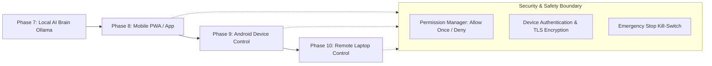

# JARVIS Future Roadmap: Mobile AI & Permission-Based Device Control

**Document Version**: 1.0  
**Project Root**: `D:\JARVIS`  
**Status**: Strategic Architecture Specification (Deferred to Future Phases 8–10)

---

## 1. Executive Summary

This specification defines the mandatory long-term roadmap for **JARVIS Mobile AI**, enabling direct access from an Android mobile phone to control both the mobile device and the Windows laptop using natural language, voice, and text — **strictly with explicit user permission**.

> [!IMPORTANT]
> **Implementation Policy**: As per project guidelines, Phases 8, 9, and 10 will **not** be started until Phase 7 (Local AI Brain with Ollama) is fully completed, tested, and approved. This document establishes the architectural foundation so future mobile integration will integrate seamlessly without rebuilding the system.

---

## 2. Roadmap Phases Overview

---

## 3. Phase Specifications

### Phase 8 — JARVIS Mobile Interface (PWA / App)
- **Frontend Architecture**: Mobile-optimized, responsive holographic HUD (Stark Industries aesthetic).
- **Voice & Chat**: Real-time push-to-talk microphone streaming, speech-to-text, and neural voice synthesis supporting **English, Tamil, and Tanglish**.
- **Telemetry & Status**: Live connection indicator, AI state machine (Idle, Listening, Processing, Thinking, Speaking, Executing, Error), battery/power cells gauge, and hardware matrix.
- **Security**: Authenticated WebSocket / HTTPS sessions with biometric or token pairing; zero unauthenticated public ports.
- **Emergency Stop**: Dedicated, prominent red Emergency Stop button accessible on all screens.

### Phase 9 — Android Device Control (Strictly Authorized)
- **Permitted Actions**:
  - Launch approved applications.
  - Navigate to permitted screens.
  - Read battery status and device diagnostics.
  - Flashlight toggle (where supported).
  - Launch camera with explicit prompt.
  - Set alarms and reminders via Android Calendar / Clock intents.
  - Access approved notifications.
  - Initiate phone calls (only with explicit pre-call confirmation).
  - Draft SMS / messages (send **only** after explicit user review and confirmation).
  - Search approved media and documents in public storage.
- **OS Compliance**: Strict adherence to official Android APIs, Android Intents, and Accessibility Services. Zero root bypasses, zero permission hijacking, zero covert background monitoring.

### Phase 10 — Laptop Remote Control
- **Remote Laptop Operations**:
  - Open and close approved Windows applications.
  - Browser navigation and safe web search.
  - File search within approved directories (`D:\JARVIS`, Documents, Downloads, Desktop).
  - Screen capture and volume adjustment.
  - Approved keyboard dictation into active apps.
- **Mutual Authentication**: Laptop backend requires cryptographically signed tokens from paired mobile devices before accepting automation commands.

---

## 4. Strict Permission and Safety Policy

### Rule 1 — Mandatory User Authorization
JARVIS must **never** assume permission simply because a command was uttered conversationally. Every device action must pass through the `PermissionGuard` before execution.

### Rule 2 — Three-Tier Permission Hierarchy

| Tier | Risk Level | Policy | Action Examples |
| :---: | :---: | :---: | :--- |
| **Tier A** | **Low-Risk** | Allow if enabled in settings | Read battery %, check CPU load, launch approved app (calc, notepad), open permitted website. |
| **Tier B** | **Confirmation-Required** | **Must prompt user** with `[ALLOW ONCE]` / `[DENY]` immediately before execution | Send messages, initiate calls, delete/overwrite files, upload data, install software, run scripts, modify settings. |
| **Tier C** | **High-Risk / Restricted** | **DEFAULT BLOCKED** | Financial payments, credential retrieval, security software tampering, admin privileges, factory reset. |

### Rule 3 — No Permission Escalation
- JARVIS can **never** grant itself new permissions.
- JARVIS can **never** modify its own safety rules or disable its Emergency Stop.
- If a user denies or ignores a confirmation prompt, the action is cancelled immediately.

### Rule 4 — Explicit Action Preview
Before executing any confirmation-required action, JARVIS must present an explicit preview card displaying:
- **Requested Action**: (e.g. `send_message`, `delete_file`)
- **Target Device & App**: (e.g. Android Phone $\rightarrow$ WhatsApp / SMS)
- **Recipient / Destination**: (e.g. Phone number, email address)
- **Exact Payload**: (Full text of message or file path)
- **Consequences**: (Data modification / irreversible change)

### Rule 5 — Network & Communication Security
- Encrypted TLS/WSS communication between Mobile and Laptop.
- Device pairing via time-based cryptographically secure PIN / QR token.
- Token revocation and automatic session expiration.
- Rate limiting to defend against brute-force command injection.
- Ollama runtime is strictly bound to `127.0.0.1:11434` (never exposed directly to the public internet).

### Rule 6 — Privacy Guarantees
- No covert audio recording or background camera capture.
- No covert screenshots or unannounced location tracking.
- Clear visual HUD indicators whenever the microphone or screen is accessed.

### Rule 7 — Universal Emergency Stop
- Accessible on both mobile HUD and desktop HUD at all times.
- Immediately halts ongoing automation, cancels queued jobs, and switches visual state to Crimson Red Alert.

### Rule 8 — Modular Allowlist Architecture
The AI intelligence layer generates structured tool intents only. Tools are executed solely by the allowlisted, validated Windows/Android Automation Dispatcher. Arbitrary shell, Python eval, or unrestricted command execution is strictly barred.

